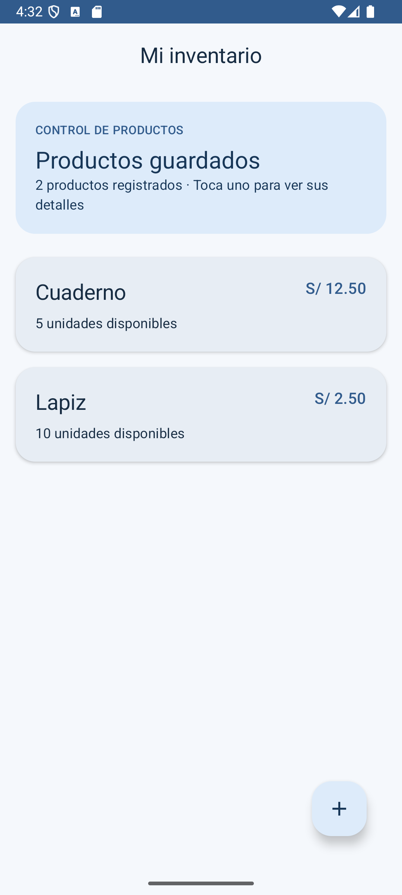
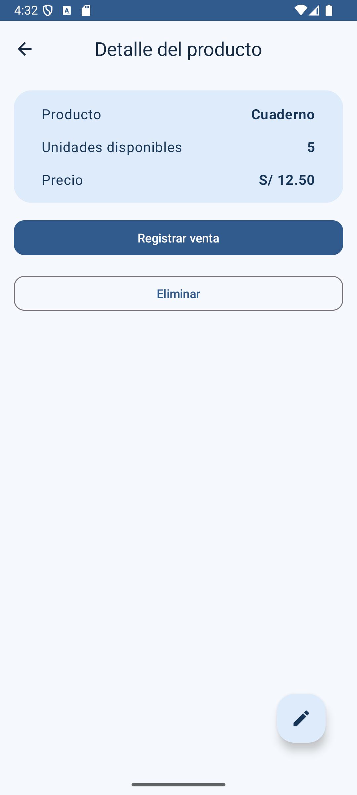
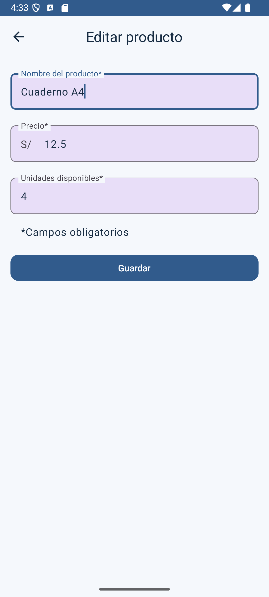
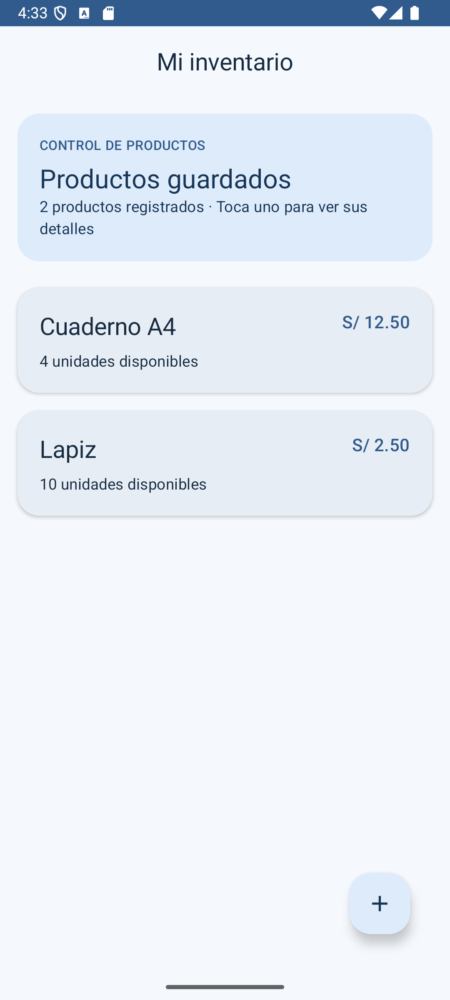
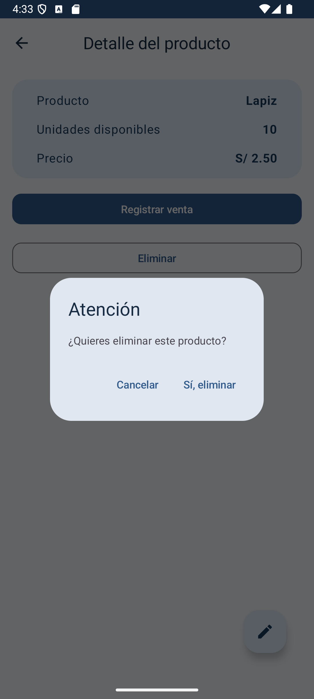
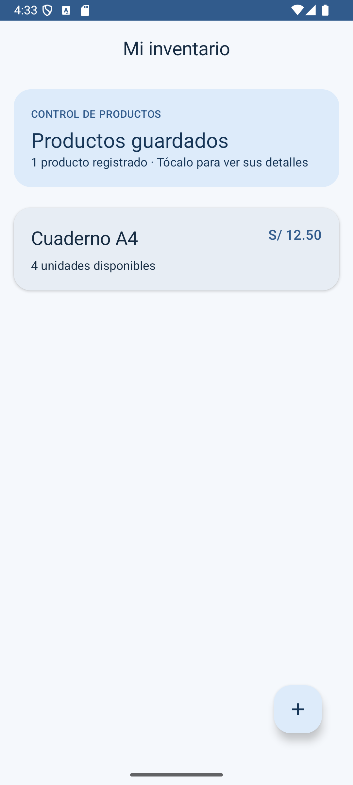
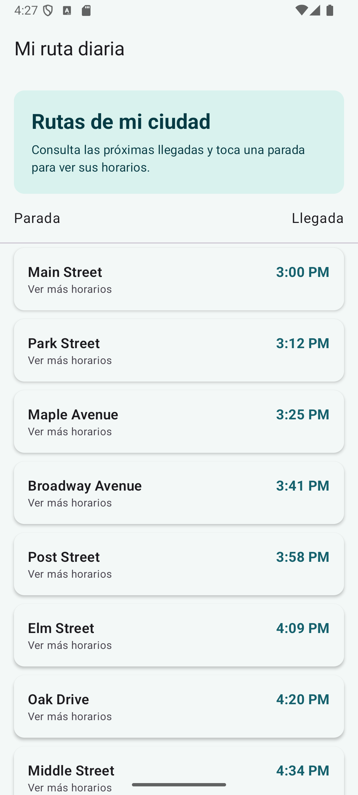
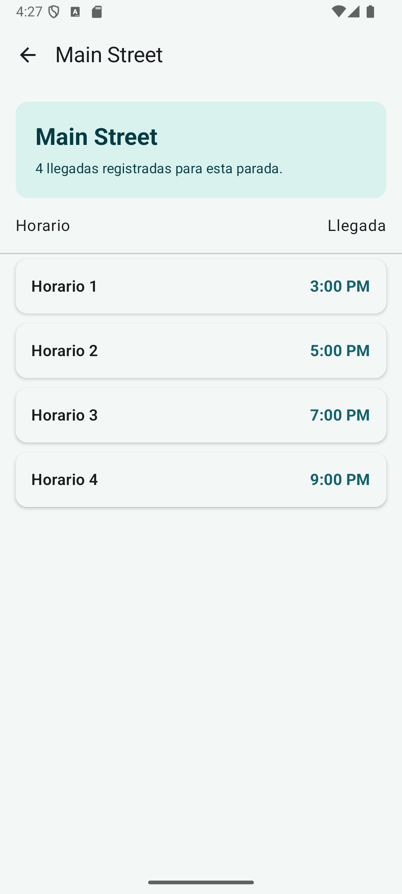

# Puntos adicionales: persistencia de datos con Room

## Texto para colocar en el laboratorio

Desarrollamos los dos módulos de la ruta **Cómo usar Room para la persistencia de datos** como aplicaciones Android independientes. Partimos de los proyectos base de Google Developer Training y completamos la lógica que faltaba. En **Mi inventario**, conectamos Room con los ViewModels mediante `Flow` y `StateFlow` para mostrar productos, registrar una venta, editar datos y eliminarlos. Comprobamos que la información se conserva al cerrar y volver a abrir la app. En **Mi ruta diaria**, relacionamos la entidad con la base SQLite precargada, implementamos consultas del DAO ordenadas por hora y filtradas por parada, y mostramos ambos resultados en Compose. Para darles una presentación propia, adaptamos las pantallas al español: inventario con tonos azules, precios en soles y tarjetas redondeadas; horarios con tonos verde agua y tarjetas de llegada. Ejecutamos ambas apps en un emulador Android y verificamos las consultas de Room con pruebas instrumentadas.

Los códigos están en el repositorio [lab08-arqMVVM](https://github.com/David-Quispe/lab08-arqMVVM), en `extras/inventario-room` y `extras/horarios-bus-room`. Los APK de depuración se entregan por separado. El material base conserva su licencia Apache 2.0 y se atribuye en los README de cada proyecto.

## Módulo 1: Cómo leer y actualizar datos con Room

Usamos el [proyecto base de Inventory](https://github.com/google-developer-training/basic-android-kotlin-compose-training-inventory-app) de la [guía oficial](https://developer.android.com/codelabs/basic-android-kotlin-compose-update-data-room?hl=es-419). Completamos la lectura reactiva de la lista, la consulta de un producto por ID, la venta que reduce el stock, la edición y la eliminación. La interfaz observa los cambios del repositorio y se actualiza sin recargar manualmente. Se validan precios y cantidades no negativos; el formulario acepta punto o coma decimal.

**Prueba realizada:** registramos «Cuaderno» con 5 unidades y «Lapiz» con 10. Al pulsar **Registrar venta**, el cuaderno pasó a 4 unidades. Después cambiamos su nombre a «Cuaderno A4» y eliminamos «Lapiz». Al cerrar y reabrir la app, «Cuaderno A4» seguía guardado. Las dos pruebas instrumentadas de `ItemDaoTest` pasaron en el emulador.

**Captura 1.** Lista con dos productos obtenidos de Room y el diseño propio del inventario.

**Captura 2.** Detalle del cuaderno antes de registrar la venta: 5 unidades.

**Captura 3.** Después de la venta, el stock cambió de 5 a 4 unidades.

**Captura 4.** Formulario de edición con los datos recuperados de Room y el nombre modificado.

**Captura 5.** La lista refleja el nombre «Cuaderno A4» y las 4 unidades.

**Captura 6.** Confirmación para eliminar «Lapiz».

**Captura 7.** Tras eliminarlo, queda un producto. La misma información permaneció después de reabrir la app.

## Módulo 2: práctica de Bus Schedule con Room

Usamos el [proyecto base de Bus Schedule](https://github.com/google-developer-training/basic-android-kotlin-compose-training-bus-schedule-app) de la [práctica oficial](https://developer.android.com/codelabs/basic-android-kotlin-compose-practice-bus-schedule-app?hl=es-419). Creamos la entidad `BusSchedule`, el `BusScheduleDao` y la base Room a partir del archivo SQLite de `assets`. El DAO devuelve un `Flow` con todos los horarios ordenados por llegada y otro `Flow` para una parada concreta. El ViewModel conecta esas consultas con dos pantallas Compose.

**Prueba realizada:** la base precargada mostró 31 horarios. Al tocar «Main Street» aparecieron solo sus 4 llegadas: 3:00, 5:00, 7:00 y 9:00 p. m. La prueba instrumentada `BusScheduleDaoTest` pasó en el emulador.

**Captura 8.** Lista general ordenada por hora de llegada.

**Captura 9.** Horarios filtrados para «Main Street».

## Cómo presentar la evidencia

Coloca el texto inicial en el apartado «Puntos adicionales» del laboratorio y agrega las capturas con sus pies. Si el espacio es limitado, usa las capturas **1, 3, 4, 7, 8 y 9**; esas muestran la lista, la actualización, la edición, el borrado y las dos vistas del bus. Agrega el enlace al repositorio y, si piden la aplicación ejecutable, adjunta los dos APK de depuración.
